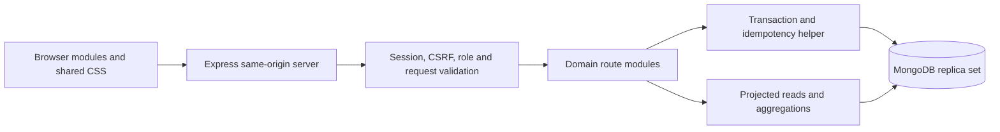

# Architecture and database design

## Request path

`server/app.js` composes security middleware, routes, static files and centralized errors. `server/core.js` contains validation primitives, permission middleware and the transaction/idempotency boundary. Route modules separate authentication, customer/catalog/stock maintenance, order/payment lifecycle, account/history management and reporting. `server/models.js` defines data constraints and indexes. `server/index.js` validates startup topology and handles shutdown.

Business decisions remain close to their route handlers in this small application. This avoids redundant controller/repository abstractions. If a domain gains several independent callers, extract its operations into a service rather than duplicating business rules.

The frontend has one state object, an API helper, shell/page rendering, table/pagination helpers, and shared dialog/form submission behavior. Values inserted into markup are escaped. Input amounts use decimal-string parsing rather than floating-point multiplication. New form submissions retain a key across network retries; changing data creates a new key. Native dialogs provide focus containment and Escape handling.

## Collections and relationships

| Collection | Purpose and relationships | Important indexes |
|---|---|---|
| users | Business members; role, active status, password hash | Unique email; creation date/id |
| sessions | Hashed opaque identifiers; user; CSRF; expiry | Unique hash; TTL expiry; user |
| customers | Business identity and contacts; archive flag | Unique code; active/date/id; active/name/id |
| products | Product/service catalog; stock; price; threshold | Unique SKU; active/date/id; active/name/id; active/type/stock |
| orders | Customer reference and snapshot; bounded item snapshots; total/paid/state | Unique number; date/id; state/date/id; customer/date |
| movements | Product, optional order, actor, signed stock delta and reason | Product/date/id; date/id |
| payments | Order, actor, amount/reference; original/reversal links | Order/date/id |
| audits | Actor, action, entity/id, reason | Date/id |
| operations | User-scoped key, request fingerprint, committed response | Unique key |
| policies | Shared version record serializing administrator access changes | Unique key |

Mongoose also creates MongoDB's normal `_id` index. Inspect the exact declarations in `server/models.js`; do not infer deployed indexes from this document alone. The additive index script is the setup/migration mechanism. Production automatic index builds are disabled.

Database references are not SQL foreign keys. The server checks references inside transactions before creating/confirming orders. There are no public deletion APIs for referenced records. Historical names and prices are embedded deliberately to survive later catalog edits. History name resolution uses batched Mongoose populate with limited selected fields, not one query per row.

## Atomicity and concurrency

Order confirmation validates a live customer and writes its version, then conditionally updates each catalog record. Stocked products must have `stock >= quantity`. It saves the order, movements, audit event and operation result in the same MongoDB transaction. Cancellation reverses stock in the same way. All operations use fresh documents inside each native session `withTransaction` retry callback; no in-memory document is reused after an abort.

The database's snapshot isolation and write conflict retries serialize competing changes to the same stock/order records. A version write also prevents concurrent catalog/customer archival from silently bypassing confirmation checks. Payment additions and reversals write the shared order balance, so competing payments cannot independently spend the same remaining balance.

Customer edits use optimistic concurrency: PATCH matches `_id` and the supplied `version`, updates the editable fields and increments the version within the transaction. A stale version returns `409 EDIT_CONFLICT` without recording a successful edit audit. The browser reloads the latest record and retains locally changed fields for review before resubmission. The existing `_id` index is sufficient; this change requires no new index. Catalog type is immutable after creation.

An operation row is checked before and within the transaction. Its unique key protects simultaneous duplicate requests. A duplicate-key loser looks up the winner's committed response. A different request fingerprint produces HTTP 409. Transactions use snapshot read concern and majority write concern. A standalone database cannot provide this workflow and is refused at startup; there is no silent partial-write fallback.

The administrator policy record prevents write skew when different admins change access simultaneously. Self-demotion/deactivation is refused; the system retains at least one active administrator.

## Algorithms and complexity

Let `k` be order lines (at most 50), `p` page size (at most 100), and `n` matching records.

- Draft construction uses one `$in` catalog query and a `Map`: O(k) application time and space, avoiding repeated product lookup and N+1 queries.
- Confirmation/cancellation: O(k) conditional writes and movements, with O(k) bounded embedded order data. Writes are sequential inside the transaction; parallel transaction operations are intentionally avoided.
- Common indexed list reads: approximately O(log n + offset + p) retrieval plus count cost. Offset pages are bounded but not constant-time.
- Substring search: O(n) candidate matching in the worst case. Metacharacters are escaped; the user cannot supply an arbitrary regular expression.
- Dashboard/report aggregation: O(n) matching records, with small server-side grouped output and bounded detail rows. Summaries are not cached.
- History population: a fixed set of batched reference queries for a bounded page, not one round trip per record.
- Client rendering: O(p) table work; page navigation replaces the active page. Search requests are debounced and stale responses ignored.

Low-stock comparison uses `$expr`; the active/type/stock index can narrow candidates but does not eliminate scanning for the threshold comparison. Its query plan was not measured in the recorded benchmark; only the representative customer-page plan was measured.

## Verification boundary

The release run passed 18 backend tests and 15 Chrome cases. These verify the exercised transaction, customer-conflict, report-race, session-recovery and responsive behaviors. Model/index declarations were reviewed against this document; their presence in an external database was not checked. Replica-set tests do not validate a sharded deployment, Atlas, production proxy behavior or production capacity. See [verification.md](verification.md).

## Safe evolution

Before adding a unique index to an existing database: inspect duplicates without exposing personal data, agree a remediation, take an appropriate backup, add the index, and verify it. Never resolve conflicts through an automatic reset. Do not run synthetic fixture tools against a supplied URI: their database is always generated locally.

For growing data, measure before replacing offset pagination with cursors, introducing indexed prefix/full-text search, or caching aggregates. Do not add queues or Redis merely because they are common in larger systems.
